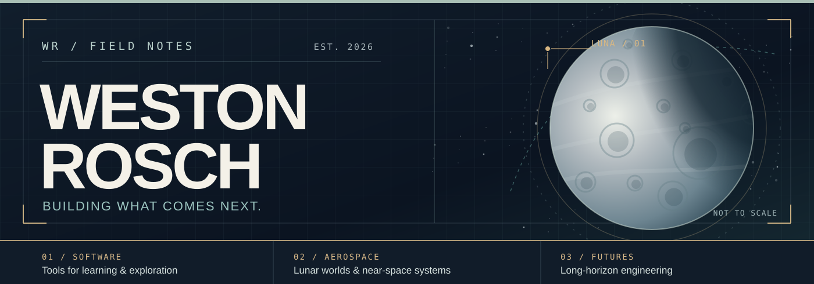
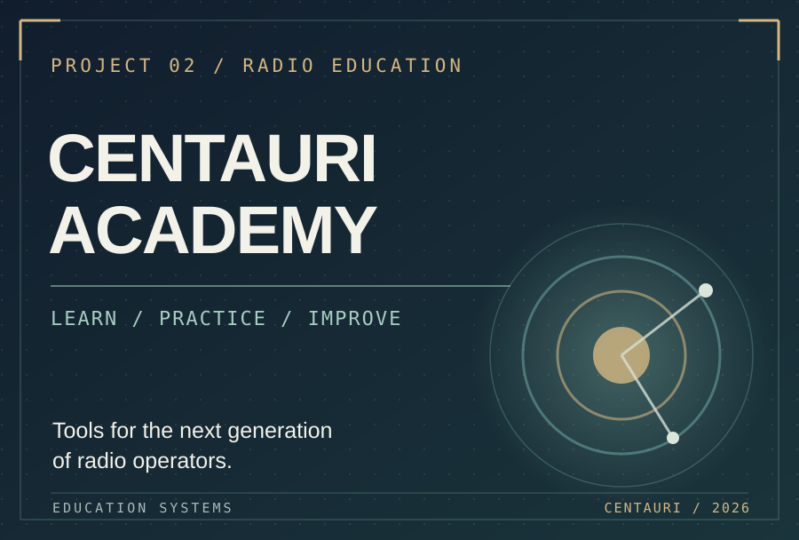
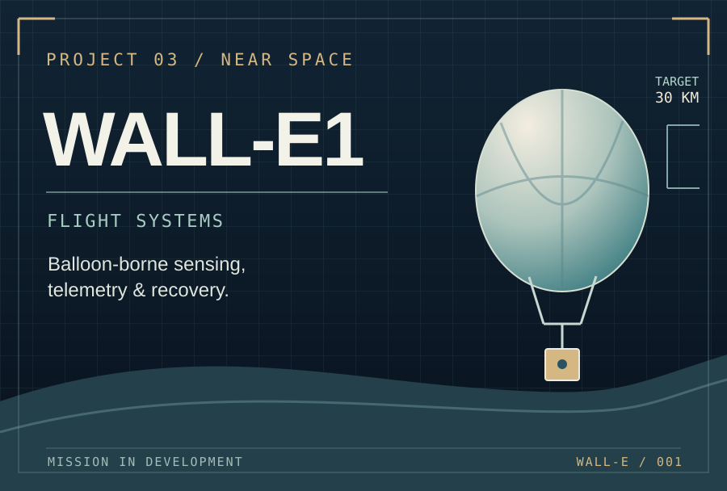

 

**STUDENT · DEVELOPER · FOUNDER** &nbsp; / &nbsp; SAN FRANCISCO BAY AREA

*Building tools for learning, exploration, and the long term.*

  
  
  
  

### 01 / SELECTED WORK

<table>
<tr>
<td width="50%" valign="top">

<h3>01. Centauri Lunar Atlas</h3>

An interactive 3D Moon built for the <b>NASA Space Apps Challenge 2026</b>. Lunar terrain, landing sites, illumination, and exploration — all in the browser.

<a href="https://moon.westonrosch.com">Explore the atlas</a> · <a href="https://github.com/InterstellarNerd8760/lunar-atlas">Source code</a>

</td>
<td width="50%" valign="top">

<h3>02. Centauri Academy</h3>

Amateur radio exam preparation, made accessible. Practice tools, readiness scoring, analytics, and AI-assisted learning.

<a href="https://centauriacademy.app">Launch Centauri Academy</a>

</td>
</tr>
<tr>
<td width="50%" valign="top">

<h3>03. WALL-E1</h3>

A near-space weather balloon with a Raspberry Pi Pico flight computer, environmental sensing, LoRa telemetry, and recovery systems.

<a href="https://github.com/InterstellarNerd8760/WALL-E1">Mission repository</a>

</td>
<td width="50%" valign="top">

<h3>04. The Personal Archive</h3>

A growing home for project notes, experiments, technical write-ups, and ideas about humanity's future.

<a href="https://westonrosch.com">Visit westonrosch.com</a>

</td>
</tr>
</table>

### 02 / SYSTEMS IN DEVELOPMENT

| Project | Current direction |
| :--- | :--- |
| **Lunar Atlas** | Terrain rendering, flight controls, data layers, and mission information |
| **Centauri Academy** | New exam coverage, better study tools, and Centauri+ |
| **WALL-E1** | Flight hardware, telemetry, and ground-station software |
| **Personal site** | An expanding archive of projects, reflections, and research |

### 03 / TOOLKIT & INTERESTS

`TypeScript` · `Python` · `React` · `Three.js` · `Node.js` · `PostgreSQL` · `Microcontrollers`

Aerospace engineering &nbsp; / &nbsp; Scientific visualization &nbsp; / &nbsp; AI &nbsp; / &nbsp; Education &nbsp; / &nbsp; Long-horizon technology

---

**CURIOSITY &nbsp; → &nbsp; EXPERIMENTATION &nbsp; → &nbsp; ENGINEERING**

<a href="https://westonrosch.com">WEBSITE</a> &nbsp; / &nbsp; <a href="https://x.com/rosch_weston">X</a> &nbsp; / &nbsp; <a href="https://www.instagram.com/rosch_weston">INSTAGRAM</a>

