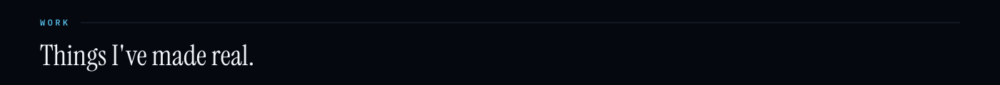
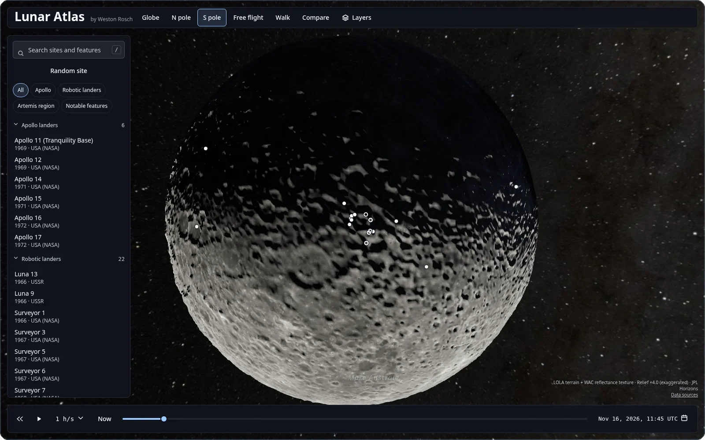
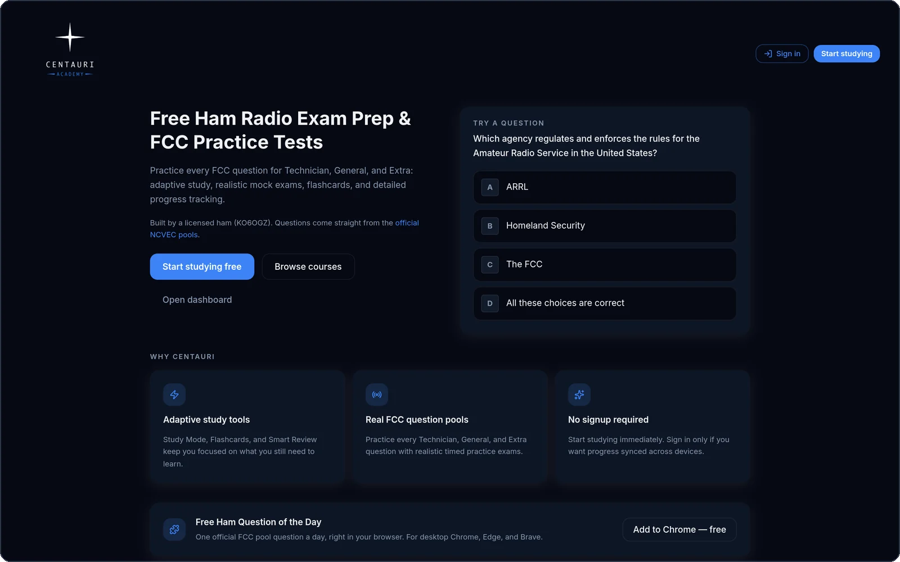
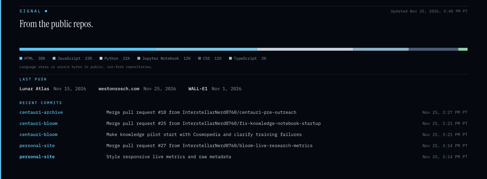
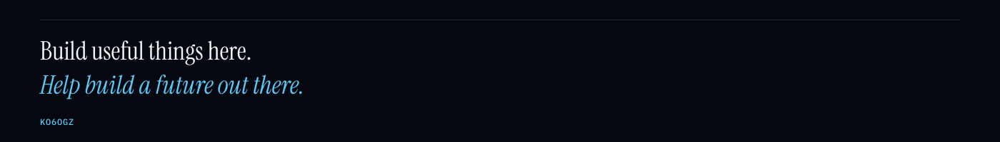

  

I'm Weston, a 10th grader in San Francisco. I build software, mess with radios, and work on things that go up. Callsign KO6OGZ.

  
  &nbsp;
  
  &nbsp;
  

  

**Lunar Atlas**

A 3D Moon I built for the NASA Space Apps Challenge 2026. You can visit landing sites, fly over the terrain, and see where the Sun and Earth sit above the horizon.

[Explore the atlas](https://moon.westonrosch.com) · [Source](https://github.com/InterstellarNerd8760/lunar-atlas)

**Centauri Academy**

Free FCC ham radio exam prep for the Technician, General, and Extra question pools, plus a Question of the Day Chrome extension. I started it while studying for my own license.

[centauriacademy.app](https://centauriacademy.app)

**Centauri Bloom**

An open-source, community-driven project to train a small language model from scratch using volunteer compute. We're starting with reproducible training experiments and building toward collaborative model development.

[Project page](https://westonrosch.com/projects/centauri-bloom/) · [Source and contributions](https://github.com/InterstellarNerd8760/centauri-bloom)

**Centauri Archive**

An independent project developing a durable, self-describing record of Earth, life, and human civilization for potential interstellar carriage. The archive includes curated photographs, an encyclopedia, and experiments in decoding and error recovery.

[Explore the archive](https://interstellarnerd8760.github.io/centauri-archive/) · [Source](https://github.com/InterstellarNerd8760/centauri-archive)

**WALL-E1**

A high-altitude balloon for my school's Space Club. Raspberry Pi Pico flight computer, environmental sensing, GPS tracking, and planned LoRa telemetry. First launch is targeted for spring 2027.

[Mission notes](https://westonrosch.com/projects/wall-e/) · [Repo](https://github.com/InterstellarNerd8760/WALL-E1)

TypeScript · React · Python · Node · Three.js

  

  

  <a href="https://westonrosch.com">westonrosch.com</a>
  &nbsp;·&nbsp;
  <a href="https://x.com/rosch_weston">X</a>
  &nbsp;·&nbsp;
  <a href="https://github.com/InterstellarNerd8760">GitHub</a>
  &nbsp;·&nbsp;
  <a href="https://www.instagram.com/rosch_weston">Instagram</a>
  &nbsp;·&nbsp;
  <a href="mailto:hello@westonrosch.com">hello@westonrosch.com</a>

